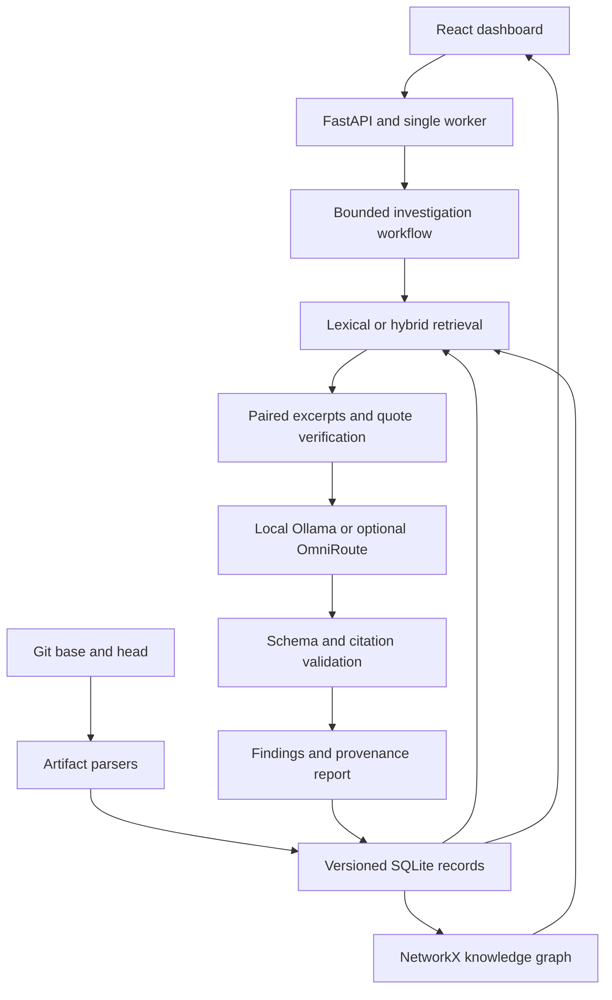

# VIGILANT — Graphify project handoff

VIGILANT is a local research application for software traceability and consistency investigation across Git revisions. Preserve the existing implementation, graph and immutable experiments. The requested follow-up is to review the architecture and evidence coverage and help improve independently measured consistency accuracy beyond 75%, while operating with free local models on 32 GB RAM.

Graphify was explicitly requested but no Graphify tool or installable search result was available in this session. This package is a generic handoff, not a claimed Graphify integration. It includes a real recorded snapshot in JSON, node/edge CSV and GraphML. Native Graphify import compatibility has not been tested.

## System architecture



The workflow is scripted and bounded, not a set of independently autonomous LLM agents. Stage logs show actual tool execution. Dependency neighborhoods propose impacts; they do not establish causation. Candidate similarity links must not be promoted to true IMPLEMENTS relations without evidence.

| Responsibility | Implementation | Contract |
| --- | --- | --- |
| Git ingestion and parsers | `ingestion/` | Commit-pinned content, artifact IDs, hashes and source ranges |
| Persistence | `database/store.py` | SQLAlchemy records; immutable snapshot keys; SQLite locally |
| Structural graph | `knowledge_graph/graph.py` | Directed multigraph; relation, method, confidence, revision provenance |
| Trace recovery | `traceability/recovery.py` | Similarity candidates separate from declared links |
| Retrieval and embeddings | `retrieval/index.py`, `rag/evidence.py` | BM25/TF-IDF, optional MiniLM hybrid; graph neighbors; verified quotes |
| Orchestration | `agents/workflow.py` | Deterministic bounded investigation and conservative findings |
| Models and prompts | `llm/providers.py`, `llm/context.py`, `llm/ollama.py`, `llm/omniroute.py` | Neutral schema, complete selected excerpts, explicit omissions, citation aliases |
| API and UI | `backend/app.py`, `frontend/src/` | Queue, reports, graph navigation and JSON/CSV/HTML exports |
| Model comparison | `scripts/evaluate_local_models.py` | Digest-pinned sequential calls; resume; no partial scores or label leakage into prompt |
| Graph export | `scripts/export_graph.py` | Read-only, one repository/commit per export; JSON, CSV, GraphML |

## Models and evidence

Current selectable local candidates: `qwen3:8b`, `qwen2.5-coder:14b`, `qwen3:14b`. Their VIGILANT accuracy is unmeasured. Ollama runs at 8,192 context / 512 output tokens, one model at a time, with structured output and explicit completion checks. The historical model is Qwen2.5-1.5B-Instruct; its saved observations are preserved. Optional OmniRoute does not provide free or unlimited inference by itself; gateway/account eligibility must be checked.

Evidence has `artifact_id`, `evidence_id`, repository/project, commit, file, range, hash, quote and retrieval method. Changed base/head windows additionally share `pair_id`. The prompt groups versions atomically within a fixed budget. Output has decision/consistency, confidence, evidence IDs, affected artifacts, reason and uncertainty. Validation checks schema and supplied citations; semantic entailment remains unmeasured.

Graph nodes represent version-scoped artifacts. Edge types include DEPENDS_ON, CALLS, TESTS, IMPORTS, EXPOSES_API, CONSUMES_API and supplied trace relations. Exported fields retain the original `method`, `confidence`, `evidence`, repository and commit. GraphML nested lists/dictionaries are JSON strings. Node IDs are artifact IDs within the single exported commit. Do not merge revisions merely because artifact IDs match; retain revision as part of the scope. Temporal change records are separate from this structural snapshot.

## Measured status and requested review

The saved consistency study has 12 authored scenarios and 60 calls over five configurations. All outputs are UNCERTAIN: 25% label agreement, macro F1 0.10, zero decisive coverage, equal to always-UNCERTAIN. All 251 historical RAG generations and mixed retrieval results are preserved. Software tests passing does not establish model accuracy. See `docs/LOCAL_MODELS_32GB.md` for commands and evaluation safeguards, and the release verification report for current checks.

Please inspect evidence omissions, missing contract/implementation pairs, call-resolution ambiguity, unsupported language constructs and trace provenance. Propose targeted changes with validation-set evidence. Compare models with identical inputs first, then separate prompt/context ablations to identify what caused a change. Select once on validation, freeze the model/prompt, and evaluate independent held-out repository changes. Do not invent annotations, reuse diagnostic cases as independent tests or claim >75% without measurement. Distributed jobs, webhooks, RBAC and external observability remain production gaps documented in `docs/ARCHITECTURE_COVERAGE.md`.

## Export contents and reproduction

`graph.json`, `nodes.csv`, `edges.csv`, `graph.graphml` are from the exact repository and commit in `EXPORT.json`. The source is `data/snapshots/vigilant.db`, read with SQLite read-only mode. It is an example snapshot, not the entire database. Export another saved scope with:

```bash
python scripts/export_graph.py --repository REPOSITORY_ID --commit COMMIT_SHA --output handoff/another-scope
```

The full release additionally contains code, historical experiments, source/data manifests, implementation/run guides, Word/PDF research drafts and the demonstration deck. Model weights and installed dependencies are intentionally downloaded during setup rather than embedded in the source archive.
