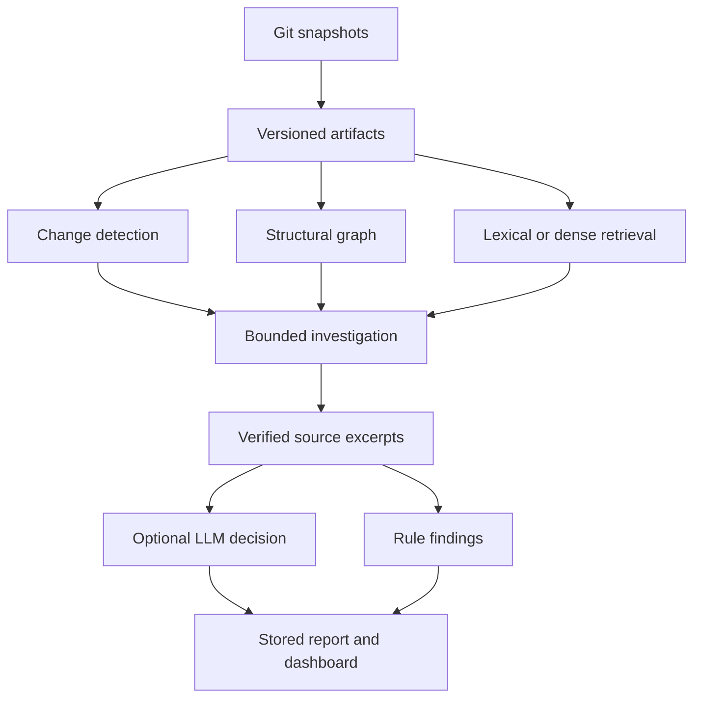

# VIGILANT — run and understand the complete local project

Engineering release: 16 October 2026. Use the full `VIGILANT-project.zip`.
This guide describes the implemented single-user research application. It does not
claim production deployment or a scientifically validated high-accuracy model.
The original datasets, experiments, graph snapshots and papers are included.

## 1. Fast start

Extract into an empty directory. Open a terminal **inside the extracted VIGILANT
folder**, containing `requirements-core.txt` and `backend/`. Keep its folder tree
together. Install Python 3.12, Git and Node.js/npm first. Dependency installation
needs internet access. Model weights and dependency environments are downloaded
separately because they are large and machine-specific.

### Windows PowerShell

Move the extracted VIGILANT folder's contents into the requested empty directory:

```powershell
Set-Location -LiteralPath 'C:\Users\Ankith\Downloads\Code- Vigilant'
.\Setup-Windows.ps1
.\Start-VIGILANT.ps1
```

Open <http://127.0.0.1:8000>. If PowerShell blocks a script, review it and use a
process-scoped execution policy consistent with your computer's policy. No permanent
system policy change is required. Windows execution has not been performed here.

### Linux

```bash
cd VIGILANT
bash scripts/setup.sh
.venv/bin/python -m uvicorn backend.app:app --host 127.0.0.1 --port 8000 --workers 1
```

Setup creates `.venv`, installs pinned core dependencies, builds React, restores a
working database if missing, repairs checkout paths, synchronizes saved experiments,
and runs pytest. It does not rerun saved LLM experiments. Exactly one server process
is supported by the local queue.

The default profile uses SQLite, NetworkX and lexical retrieval. No model account,
weights or inference fee is required; saved model results remain viewable.

## 2. Real saved demonstration

1. Select repository `08-api-changed`, snapshot beginning `892a3d521`.
2. Open **Change Analysis**, **Impact Analysis**, then **Knowledge Graph**.
3. Inspect **Consistency Findings** and **Evidence**. Open a record for paths,
   line ranges, hashes and commit identities.
4. Open **Agent Investigation** for tool trajectories and **Reports** for the
   full model output and separate rule findings.
5. Run a fresh investigation using base `1762adac6`, that head, and
   **Deterministic tools only**. The API returns a job ID; the completed job points
   to the final report's separate run ID.

This is an authored API-change scenario, not an independently confirmed production
defect. The saved local-model report abstains with UNCERTAIN. See `docs/DEMO_RECORD.md`.

The report drawer exports full JSON, findings CSV or printable HTML. For PDF, open
the HTML and use browser Print → Save as PDF. There is no native PDF-generation API.

## 3. Free OmniRoute setup

OmniRoute routes requests; it is not an LLM or an unlimited free token grant. Use
an eligible free provider account or local backend, with paid billing and fallback
disabled. The allowlist records your eligibility choice; VIGILANT cannot inspect
provider billing. Gateway-side configuration remains your responsibility.

Follow `docs/OMNIROUTE_FREE.md`. Windows commands:

```powershell
.\Start-OmniRoute.ps1
# Connect an eligible free provider in the gateway, then in another terminal:
.\Start-VIGILANT-OmniRoute.ps1 -Model 'EXACT_PROVIDER/MODEL_FROM_YOUR_GATEWAY'
```

The launcher privately prompts for the gateway key. Copy the exact route from its
catalog; do not guess it. Select **OmniRoute (configured free route)** in the UI.
A connected gateway/account was unavailable here: live inference and accuracy are
**NOT RUN**. Linux environment commands are in the same guide; use `.venv/bin/python`.

`.env.example` documents settings; the Python app does not automatically load it.
`scripts/check_omniroute.py` reads the catalog without generating tokens. The client
has no automatic retry or model fallback. Stop on quota exhaustion until a legitimate
reset. Keep credentials out of code and archives.

`VIGILANT_FREE_ONLY=1` is the default: API and CLI provider selection reject
`cloud`, `gemini` and `claude`. Keep this enabled. Direct use of provider classes and
externally configured services remains an operator responsibility. Local execution
still consumes hardware and electricity.

## 4. Optional local models

Use `Setup-Windows.ps1 -DownloadModels` or `bash scripts/setup.sh --models`.
This installs CPU PyTorch/model libraries, downloads and checks the pinned weights:

| Role | Model | Revision |
| --- | --- | --- |
| Embeddings, float32 | sentence-transformers/all-MiniLM-L6-v2 | `1110a243fdf4706b3f48f1d95db1a4f5529b4d41` |
| Historical reasoning, bfloat16 | Qwen/Qwen2.5-1.5B-Instruct | `989aa7980e4cf806f80c7fef2b1adb7bc71aa306` |

The reasoner uses deterministic decoding, constrained JSON and bounded input/output.
It is the historical small CPU model, not a proven best model. Hardware performance
and bfloat16 support vary. `VIGILANT_LLM_PATH` may point at separately staged weights.
Use `--semantic` on the pipeline CLI for MiniLM retrieval when installed. Missing
weights/provider errors are not successful accuracy measurements.

## 5. System design and code explanation



| Code | Responsibility and limits |
| --- | --- |
| `ingestion/git.py`, `service.py` | Resolve commits, read versioned files and import records without executing imported code. |
| `ingestion/parsers.py` | Python AST and Tree-sitter Java/JS/TS; requirement/doc/test/API/config artifacts. Static parsing cannot prove dynamic dispatch. |
| `ingestion/models.py` | Pydantic artifact/decision contracts, IDs, content hashes and timestamps. |
| `database/store.py` | SQLAlchemy tables for projects, repos, commits, artifacts, traces, graph, changes, evidence, jobs, findings and experiments. SQLite is tested. |
| `change_analysis/diff.py` | File/symbol additions, changes, deletions and renames across two snapshots. |
| `knowledge_graph/graph.py` | Structural relationships and bounded impact paths. Similarity candidates are not confirmed IMPLEMENTS edges. |
| `retrieval/index.py` | TF-IDF/BM25, optional MiniLM vectors, reciprocal-rank fusion and local embedding cache. |
| `traceability/recovery.py` | Bounded requirement/code candidates with scores, methods and status. |
| `rag/evidence.py` | Retrieve excerpts; verify source, commit, ranges and hashes. Valid citations do not prove semantic entailment. |
| `consistency/rules.py` | Deterministic review rules for interfaces, tests and declared relationships. |
| `llm/providers.py`, `llm/omniroute.py` | Optional model calls, structured parsing, evidence budgets and citation validation. Errors and uncertainty remain visible. |
| `agents/workflow.py` | Fixed tool orchestration, trajectory/timing, verification and report persistence. |
| `backend/app.py`, `exports.py` | FastAPI, queue, token, pagination, exports and job metrics. |
| `frontend/src/main.jsx`, `Graph.jsx` | React JavaScript dashboard, scoped views, graph and provenance drawer. |
| `evaluation/`, `scripts/run_*.py` | Metrics, experiment records, frozen protocols and explicit research runners. |

### Agents, KG and RAG

The roles are Planner, Artifact Investigator, Change Investigator, Traceability
Investigator, Evidence Investigator, Consistency Investigator, Verifier and
Explanation Generator. They are responsibility labels around a fixed Python
workflow, not eight independent LLMs. The standard investigation has 12 stages:
commit resolution, imports, diff, base/head graphs, impact, trace recovery,
retrieval, rules, quote verification, optional model call and persistence.

When available, embeddings contribute semantic candidates to hybrid retrieval.
Graph paths extend context. Bounded source excerpts are checked before prompting.
The historical traceability RAG experiment only reranks the hybrid top five and
cannot improve Recall@5 or @10. The expanded OmniRoute investigation uses a larger
context budget than the historical small-model profile; comparing these is a
model-plus-context experiment, not a controlled model-only comparison.

SQLite persists canonical data; NetworkX computes graph relationships. NumPy
vectors and SQLite caching provide local semantic indexing. FAISS, Chroma, pgvector
and Neo4j are not required or implemented services. See `docs/KNOWLEDGE_GRAPH.md`
and `docs/INTERFACE_CONTRACTS.md` for graph/provenance contracts.

### Queue and access behavior

Before queuing, base/head refs resolve to immutable commits. One worker accepts
20 outstanding jobs; more receive HTTP 429. New jobs persist their requests.
After restart, QUEUED work resumes; RUNNING work becomes FAILED with an interruption
message rather than silently replaying a potentially completed model call. Inspect
saved reports before resubmitting. Historical pre-release queue records lack this
request schema and are not automatically replayed. This is not a distributed broker.

Set `VIGILANT_ACCESS_TOKEN` before server start for shared-token access. Apply the
same token under **Workspace access**; it stays in browser session storage. Data
routes require `Authorization: Bearer <token>`. Health/auth-status/static assets
remain public. This is not per-user login or RBAC. Keep the loopback binding.

## 6. API and command-line usage

Open <http://127.0.0.1:8000/docs> with token mode off. Protected schema routes require
the same authorization header when token mode is on.

| Route | Function |
| --- | --- |
| `GET /api/health`, `/api/auth/status` | Liveness and access mode |
| `GET/POST /api/projects` | List/create projects |
| `POST /api/repositories/import` | One local path or public HTTPS GitHub/GitLab URL |
| `GET /api/artifacts`, `/api/traceability`, `/api/changes` | Filtered, paginated versioned records |
| `GET /api/graph`, `/api/impact`, `/api/rag` | Graph, impact candidates and verified BM25 evidence |
| `POST /api/analysis/run` | Queue repository/base/head/model/semantic request |
| `GET /api/reports/{run_id}` | Poll a job or read the full report |
| `GET /api/reports/{run_id}/export?format=json` | JSON, CSV or HTML |
| `GET /api/agents`, `/api/consistency`, `/api/evaluation` | Trajectories, findings, saved experiments |
| `GET /api/metrics` | Prometheus-text job counts |

Lists accept scope filters and `limit`/`offset`; follow `has_more`/`next_offset` where
supplied. `/api/rag` requires repository, commit_id and query; it explicitly reports
semantic entailment as unverified.

Create a fresh deterministic report without inference:

```bash
.venv/bin/python scripts/run_pipeline.py --repo data/changebench/08-api-changed --base 1762adac6 --head 892a3d521 --model none
```

For a new repo, place it under `data/repos`, `data/raw` or `data/changebench` and
import it, or use the UI's public repository URL. Issue/wiki hosting APIs are not
implemented. The import clones at depth 40; older revisions may need a manual fetch.

`watch_repository.py` polls a local checkout, without remote fetch. Use one process
and a distinct `--state` per repo. First start records current HEAD; later changes
trigger analysis. Mismatched repo state is rejected. A crash after report completion
but before state write can duplicate a report; exactly-once scheduling is not claimed.

## 7. Verification commands

```bash
.venv/bin/python -m pytest -q
npm --prefix frontend run build
.venv/bin/python scripts/audit_results.py
.venv/bin/python scripts/audit_rag_observations.py --provider-source evaluation/frozen/20261007/providers.py.txt
npm --prefix tools/browser ci
node tools/browser/node_modules/playwright/cli.js install chromium
.venv/bin/python scripts/run_frontend_check.py
```

On Windows use `.\.venv\Scripts\python.exe`, or `Test-Frontend.ps1 -InstallBrowser`.
Linux browser operation may require OS dependencies. Browser checks use a temporary
server and SQLite backup of the snapshot. Frozen experiments are untouched.
The archived provider is needed for historical fingerprints; altered code correctly
fails that audit. See `reports/codebase-20261016/VERIFICATION.md` for release evidence.
Software tests do not establish model accuracy.

## 8. Accuracy and the route to better results

| Dataset | Hybrid MAP | Hybrid + LLM RAG MAP |
| --- | ---: | ---: |
| SMOS (train) | 0.302557 | 0.306062 |
| iTrust (validation) | 0.306828 | 0.304309 |
| eTour English (test) | 0.440553 | 0.442684 |
| RTMX module-valid | 0.751515 | 0.698485 |

RAG improves two datasets slightly and worsens two. The 60-call consistency study
has 100% UNCERTAIN outputs, macro-F1 0.10 and 0% non-uncertain coverage. Its 25%
authored-label agreement equals always-UNCERTAIN. A high-accuracy consistency model
is not established; the application supports evidence collection and review.

Use the supplied follow-up protocol in `submission/research-20261016`: independent
labels including negatives; validation-only model/prompt selection; frozen unseen
test evaluation against lexical/hybrid/rules/LLM baselines; precision, recall,
macro-F1, uncertainty coverage, latency and failures reported separately. Never
remove uncertainty to inflate scores. The bounded OmniRoute evaluator can collect
a separate study after free-route connection. Do not rerun completed studies merely
to resume the project.

## 9. Deployment and troubleshooting

`docker compose up --build` uses the supplied core-only Docker recipe, one server,
host-loopback port and a named data volume. Docker was unavailable here: container
build/runtime are **NOT VERIFIED**. The recipe has no model weights or host-gateway
connection; use the native setup for the documented OmniRoute flow. The GitHub
Actions workflow runs core tests/build/audits on the complete project tree; remote
CI execution is **NOT RUN**.

- Missing modules: rerun setup with Python 3.12; never copy another machine's venv.
- Missing weights: choose deterministic/OmniRoute, or install the optional models.
- Empty views: check both repo and snapshot; run restore/sync from the project root.
  The source-only ZIP does not include full raw repositories.
- Invalid refs: ensure both commits exist in the local history.
- HTTP 401: apply the server's workspace token. HTTP 429: wait for queue capacity.
- Interrupted jobs: inspect results before explicit resubmission; use one worker.
- Port conflict: use another port (`Start-VIGILANT.ps1 -Port 8001`).
- Slow CPU inference: use deterministic mode for browsing; speed is not accuracy.

`docs/ARCHITECTURE_COVERAGE.md` maps the requested image to implemented alternatives
and missing services. Latest paper PDF/Word: `submission/research-20261016`.
Manuscripts describe frozen experiments, not all subsequent engineering fixes.

## 32 GB local models and Graphify handoff

See [LOCAL_MODELS_32GB.md](LOCAL_MODELS_32GB.md) for the three-model setup, finite comparison, resumption and accuracy protocol. Use `Start-VIGILANT-Local.ps1` for local inference. [GRAPHIFY_HANDOFF.md](GRAPHIFY_HANDOFF.md) maps the architecture, data contracts and exported graph. New release verification: `reports/accuracy-20261017/VERIFICATION.md`.
