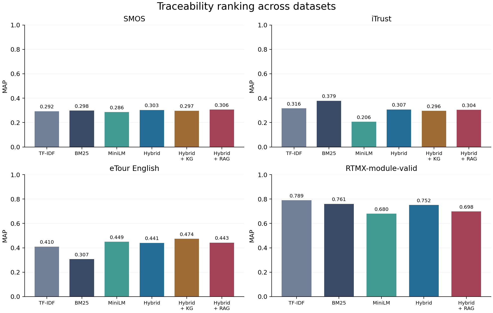
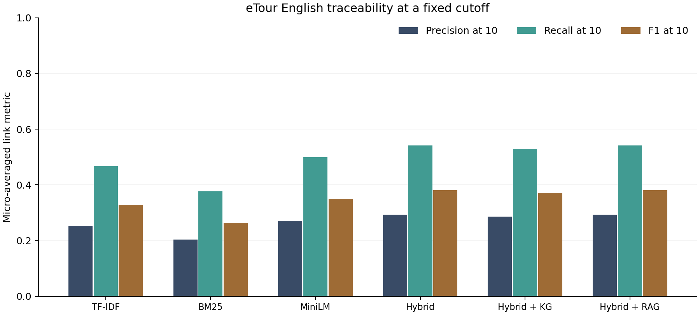
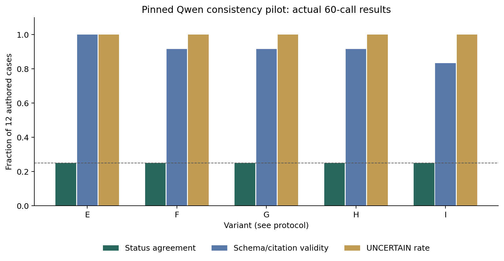

# Introduction

Software maintenance involves relationships that cross artifact boundaries. A requirement can describe behavior implemented in a backend handler, invoked by a generated frontend client and exercised by tests. A change to one artifact may leave the others unchanged. A useful investigation must identify which versions differ, locate plausible dependencies and provide enough source evidence for a reviewer to assess whether the change matters.

VIGILANT implements this investigation as a reproducible pipeline over Git repositories. It combines canonical artifacts, lexical and pretrained embedding retrieval, a structural knowledge graph, bounded impact analysis, retrieval-supported model calls and conservative consistency rules. The intended output is an inspectable report containing changed artifacts, affected candidates, trace candidates, evidence, tool outcomes and a separate model decision. Evidence retains the repository, commit, path, line range and content hash required to reopen its origin.

This thesis distinguishes an engineering achievement from an effectiveness claim. The implementation executes end to end, and its completed studies contain actual rankings and model generations. However, the available results do not demonstrate that the full local-model system classifies consistency better than an always-UNCERTAIN comparator. Retrieval effects also vary by dataset and metric. Reporting these outcomes is necessary to make the contribution assessable and reproducible.

The document is a technical draft. Author, supervisor, institution, prescribed front matter and final university formatting require confirmation. Independent semantic review, external plagiarism checks, browser validation and Windows execution remain open. No publication submission or venue-indexing claim accompanies this draft.

# Background

Traceability link recovery ranks or classifies relationships between source and target artifacts. Ranking is useful when a human examines a short candidate list; binary classification answers whether a link should be accepted. These are different decision problems. A high-ranked item can still be incorrect, and a ranking score is not automatically a calibrated probability of implementation.

Lexical retrieval uses token overlap and weighting. BM25 provides a probabilistic retrieval framework [1]. Sentence representations support cosine-based comparison of separately encoded texts [3]. VIGILANT uses a pinned MiniLM encoder [10] and combines BM25 and embedding ranks through reciprocal rank fusion [2]. The implemented fusion uses a constant of 60 and two retrieval arms. This setting is a configuration choice, not proof that fusion must improve every dataset.

A software knowledge graph records typed artifact relationships. In this project, parsed calls, imports, tests, APIs and client relationships supply structural context. A graph path is a reason to investigate an artifact, not evidence that the artifact is defective. Likewise, a recovered similarity candidate is not a proven IMPLEMENTS relation.

Retrieval-augmented generation supplies external context to a language model [4]. VIGILANT uses this idea for candidate review and consistency investigation. The original RAG formulation, the traceability literature and the implemented pipeline have different training and evaluation settings. The present experiments evaluate the implemented method directly rather than claiming a reproduction of those systems.

# Literature Review

The selected references cover retrieval, software traceability, graph-supported retrieval and tool-using agents. This is a targeted review based on primary metadata, abstracts and model documentation checked on 7 October 2026. It is not an exhaustive systematic review. The separate survey draft should expand full-text screening before any comprehensive literature claim.

LiSSA investigates RAG-based linking across requirements, code and architecture artifacts [5]. TransArC uses an intermediate architecture model to connect documentation and code [6]. Earlier ARDoCo-related work uses trace links to identify documentation/model inconsistencies [7]. These studies demonstrate that automated linking and inconsistency analysis already have substantial prior work; VIGILANT does not claim to be the first system to combine language models with traceability.

GraphRAG addresses corpus-level summarization through an entity graph and community summaries [8]. VIGILANT instead constructs a parsed software graph and performs bounded local traversal. SWE-agent studies software-engineering agents and their computer interfaces [9]. VIGILANT's current investigator follows a scripted sequence of tools. These relationships motivate design and evaluation questions, but their reported effectiveness is not numerically comparable with the present traceability and mutation experiments.

The experimental comparison in this thesis uses only VIGILANT's own rankings and predictions under its recorded populations. External paper scores are not copied into the results as if they were reproduced baselines. The reference-verification record identifies the sources and access limitations.

# Research Gap

The project targets the practical integration of version-aware artifact extraction, trace candidate recovery, structural context and inspectable model-supported investigation. Static trace rankings alone do not describe how a particular Git change propagates through a frontend, backend and tests. Conversely, a model's fluent account of a change is difficult to evaluate unless its evidence is tied to actual artifact versions.

The proposed contribution is an integrated experimental artifact and an explicit evaluation of its boundaries. It includes a controlled change benchmark with reproducible commits, a frozen multi-dataset retrieval study, complete model-call records and negative ablation results. This gap statement is a project motivation, not a verified claim that no prior system addresses software evolution or evidence provenance.

The most important unresolved research gap inside the current project is independent validation. Authored mutations and source-faithful citations are insufficient to establish reliable semantic judgments on naturally occurring changes. That limitation constrains the conclusion even when the software executes successfully.

# Problem Statement

Given a repository, a baseline Git commit and a changed commit, determine which canonical artifacts changed, which related artifacts deserve investigation, and which traceability or consistency findings can be supported by recorded evidence. The system must retain uncertainty when the available context does not justify a conclusion.

There are three related outputs. First, retrieval methods produce ordered trace candidates for a requirement. Second, graph traversal produces impact candidates with paths explaining their selection. Third, rules and model calls produce findings with source evidence. A candidate list, a structural path and a consistency decision must remain distinguishable in storage, the interface and the evaluation.

The system must not treat a missing test update as automatic proof of a defect, a lexical match as confirmed implementation, or a loading error as a generated model prediction. Reproducibility requires the recorded result to identify its dataset, input, method, model, configuration, output, label scope, metric and source record.

# Objectives

The implementation objectives are to import Git snapshots, extract supported artifact types, assign stable identities and content versions, recover bounded trace candidates, persist structural graphs and execute a complete evidence-backed change investigation. Runtime failures and uncertain decisions must remain visible.

The evaluation objectives are to compare TF-IDF, BM25, MiniLM, hybrid retrieval, graph reranking and a frozen RAG reranker; execute controlled software-change scenarios; and compare five local-model investigation variants. All comparisons use retained raw outputs and explicit ground-truth scope.

The delivery objectives are to preserve one project root with code, data, results, graphs, scripts and resume instructions, and to prepare reviewable academic drafts and a demonstration. Final acceptance by the university or a publication venue is outside the evidence available to this project run.

# Research Questions

**RQ1.** How do lexical, embedding, hybrid, graph and RAG methods compare on the selected linked-query traceability populations?

**RQ2.** Does adding retrieval, graph context, bounded investigation and temporal evidence improve local-model agreement with the authored consistency labels?

**RQ3.** Can the implemented pipeline recover real Git changes, investigate related artifacts and retain inspectable evidence and tool outcomes?

**RQ4.** What aspects of grounding and reliability are established by source/schema audits, and what still requires independent review?

RQ1 concerns recorded ranking quality. RQ2 concerns the local-model pilot, not every possible model or prompt. RQ3 concerns executed engineering behavior. RQ4 prevents structural validation from being reported as semantic accuracy.

# VIGILANT Architecture

The ingestion layer resolves commits and extracts canonical artifacts from text snapshots. The persistence layer stores projects, repositories, commits, artifact versions, trace links, graph nodes and edges, evidence, findings, analysis runs and experiments. Retrieval indexes target text; optional semantic retrieval uses the pinned encoder and a content/model-aware cache.

The graph layer builds a directed multigraph at each commit. The investigation composes base and head graphs to traverse around changed artifacts. Evidence retrieval combines ranked text with graph and change context. A verifier checks quotes, ranges and hashes before the provider receives selected excerpts. Rules produce conservative findings separately from the model's structured decision.

The local API exposes stored records and queues one bounded analysis worker. The React frontend reads the API for dashboard, repository, artifact, traceability, graph, change, impact, consistency, evidence, agent, experiment and report views. The production build exists; browser interaction validation remains blocked by the unavailable browser runtime.

The investigation has named roles but a predetermined order. The saved demonstration contains commit resolution, snapshot import, change detection, two graph builds, impact analysis, trace recovery, evidence retrieval, deterministic checks, quote verification, a model call and report persistence. This is an executed tool workflow, not evidence of autonomous plan selection.

# Methodology

## Canonical identity and versions

An artifact ID hashes the project, repository, relative path, type and symbol. Content has a separate hash and the artifact retains its commit and line range. This separation supports comparison of logical artifacts across snapshots while preserving the exact text used as evidence. Path or symbol renames require explicit change matching; stable identity alone does not solve every rename.

## Retrieval and candidate bounds

Token processing splits camel case, normalizes case and removes selected requirement identifier patterns. TF-IDF uses sublinear term frequency. BM25 and embedding arms rank the same target population. The encoder limits text to up to eight 180-word chunks, averages normalized chunk embeddings and normalizes the resulting vector. This can omit later code in a long artifact.

Hybrid scores sum reciprocal ranks from BM25 and embeddings. The implementation's automatic trace recovery returns at most three candidates per requirement, with a 0.12 threshold in the lexical fallback. These candidates retain RELATED_TO and a proposed relation with review-required status. No calibrated confidence is asserted.

## Graph context

Structural relationships include CALLS, IMPORTS, TESTS, EXPOSES_API, CONSUMES_API, DEPENDS_ON and commit MODIFIES edges. Unique static matches are preferred and ambiguous or dynamic relationships can be unresolved. The change workflow uses bounded, typically two-hop traversal and excludes broad reverse-containment propagation.

The retrieval graph experiment uses Java file relationships without gold trace edges. Its exploratory score combines normalized hybrid relevance with mean adjacent-file relevance using weights 0.85 and 0.15. This differs from the operational impact graph and from Microsoft GraphRAG. RTMX graph reranking was not run under this Java-file protocol.

## Frozen RAG reranking

For each linked query, the model receives a requirement prefix of at most 900 characters and five source/test prefixes of at most 1100 characters. Qwen assigns SUPPORTED, UNSUPPORTED or UNCERTAIN to each candidate. SUPPORTED items move to the front while all other items retain their relative order. The rest of the full hybrid ranking remains available for scoring.

The model cannot introduce candidates outside the first five. Recall@5 and Recall@10 therefore cannot improve under this experiment. MAP, reciprocal rank and nDCG can change. Prompt, evidence, schema, provider source, model/decode identity and prepared-data fingerprints must match for a cached generation to be reused.

## Evidence and conservative decisions

Evidence records contain exact text, path, line range, commit, artifact identity and hash. The verifier compares each quote with the specified artifact version. Model citations must refer to supplied IDs. Invalid generated responses are retained and handled conservatively; loading failures without output are excluded from effectiveness scoring.

The consistency decision schema requires coherent labels, reason, uncertainty, affected IDs, citation IDs and confidence within [0,1]. Non-UNCERTAIN conclusions require evidence. These checks enforce format and provenance. They do not independently decide whether the excerpt entails the conclusion.

# Dataset and Benchmark

@DATASETS@

Only requirements with at least one resolved gold link enter the ranking evaluation. This excludes 26 iTrust requirements and one eTour requirement. The policy is identical across reported retrieval methods but does not measure rejection of unlinked requirements.

SMOS, iTrust and eTour data were acquired from the pinned LiSSA replication package. Their train, validation and test roles apply to the learned-ranker study. RTMX is an external module-level subset with 22 resolved requirements and seven existing target modules. Missing modules and unresolved function labels prevent interpreting it as a comparable 24-function evaluation. Returning all seven candidates makes Recall@10 equal one regardless of ranking quality.

VIGILANT-ChangeBench stores repository, baseline commit, changed commit, change type, changed artifacts, expected affected artifacts and expected consistency status. Its twelve scenarios include requirement change/addition, code change/deletion, test change/deletion, frontend change, API change, backend change, consumer change and implementation/requirement test drift. The commits are real and reproducible; the labels are authored and partial.

@CHANGES@

The benchmark seeds declared baseline traces in relevant scenarios. It therefore checks maintenance of supplied relationships as well as structural changes, rather than independently evaluating initial trace discovery. Predictions outside a partial expected set remain unjudged. SAFA is reported separately as a versioned artifact-tree comparison.

# Implementation

Python modules separate ingestion, retrieval, traceability, graph construction, change detection, evidence, model providers, consistency and workflow orchestration. FastAPI exposes the local application and SQLAlchemy stores records. The frontend uses React and Vite. Python AST and language-specific parsing support the stated source languages, with failures retained instead of silently disappearing from reports.

The local model provider uses Transformers on CPU with four inference threads, greedy decoding, bfloat16 weights, an input limit of 3072 tokens and at most 220 generated tokens. Schema-constrained generation restricts output structure. The pinned Qwen model revision is `989aa7980e4cf806f80c7fef2b1adb7bc71aa306`. The MiniLM revision is `1110a243fdf4706b3f48f1d95db1a4f5529b4d41`. Cloud-compatible, Gemini, Anthropic and Ollama adapters exist but are not evaluated here.

Efficiency controls include embedding caches, bounded chunks, limited candidate counts, graph-hop limits and exact reuse of generated observations. The continuation ledger skips completed stages. These controls reduce repeated work; no controlled universal speedup result is claimed. Raw calls and rankings remain immutable while derived reports can be regenerated.

The project also includes installation, restoration, checkpoint and packaging scripts. SQLite backups preserve consistent snapshots. Archive creation stages and validates ZIPs before installing them. This was necessary because temporary runtimes repeatedly reset during evaluation. Recovered calls retain their original timings and provenance rather than being regenerated to obtain more favorable outcomes.

# Experimental Setup

The frozen linked-query study includes 251 actual local generations. Four completed dataset pointers identify immutable runs. Independent audits compare prompt/evidence fingerprints, raw and parsed output, schema constraints, full rankings and recomputed metrics. They verified all observations and 23 method rows containing 1484 per-query metric rows. A continuation check with zero new calls skipped every completed dataset.

Precision@10, recall@10 and F1@10 are micro-averaged over predicted requirement-target pairs. Macro Recall@k averages each query's fraction of recovered gold links. These quantities can differ. MRR averages the reciprocal rank of the first relevant target. MAP averages per-query average precision across the full ranking. nDCG uses a cutoff of ten with binary relevance. The complete raw and unrounded values remain available.

For query q with gold set G and a full ranking, average precision sums precision at every relevant rank and divides by the size of G. This differs from measuring only the first five model-reviewed candidates. A reranking operation can improve one order-sensitive metric and reduce another without changing cutoff recall.

The learned ranker uses TF-IDF, normalized BM25, embedding and token-Jaccard features. It is trained on SMOS, checked on iTrust and evaluated on eTour. Its retention rule requires validation MAP to exceed the strongest retrieval baseline. No test-based retention decision is used. The fixed graph weight is exploratory rather than preregistered.

The local-model ablation uses the same twelve controlled cases across five configurations, producing 60 observations. E is LLM-only; F adds hybrid RAG; G adds graph context; H adds bounded investigation; I adds temporal context and rules. H is scripted, and I changes multiple context elements together, limiting causal attribution.

# Results

## Traceability

@TRACE@

The eTour graph variant has MAP 0.4744 compared with hybrid 0.4406, but its micro F1@10 is 0.3713 compared with hybrid 0.3804. This illustrates why one favorable metric cannot summarize every retrieval objective. On iTrust, BM25 has MAP 0.3787, higher than the reported semantic, hybrid, graph and RAG variants. MiniLM alone leads hybrid on eTour MAP but not its fixed-cutoff F1.

## RAG

@RAG@

The RAG reranker slightly raises MAP on SMOS and eTour, lowers it on iTrust, and lowers RTMX MAP from 0.7515 to 0.6985. The eTour result is mixed: MAP and nDCG rise slightly while MRR and macro Recall@1 decline. No statistical significance or general superiority follows. All 251 outputs pass the independent full-schema check, but that is not a semantic grounding score.

## Change investigation

All twelve authored scenarios contain their expected status somewhere in the deterministic findings. The known affected sets contain @KNOWN_TOTAL@ endpoints in total, of which @KNOWN_HITS@ are recovered and @KNOWN_MISSES@ missed. Predictions outside these partial sets cannot be counted as verified false positives. These counts are regression evidence under the authored contracts, not independent impact precision/F1.

The recorded API-change demonstration changes the backend route prefix from `/items` to `/catalog`. The generated frontend client retains `/api/v1/items/{id}`. The executed workflow records twelve tool stages, eleven changed artifact records, 33 impact candidates and 24 verified excerpts. Its fifteen rule findings concern a shared cause. The local model returns UNCERTAIN.

SAFA compares artifact-tree versions containing 240 versus 360 nodes and 234 versus 355 edges. The saved comparison identifies 205 added, 85 deleted and nine modified nodes, plus 207 added and 86 deleted edges. This is temporal artifact analysis without independent consistency labels.

# Ablation Study

@ABLATION@

All five variants return UNCERTAIN for every case. Their 25% agreement with authored labels equals the always-UNCERTAIN comparator. Five generated responses fail citation validation and become uncertain. More elaborate evidence selection does not improve the observed final consistency classification.

Known endpoint recall increases across some configurations, reaching 0.72 in I, but this measures coverage of the incomplete authored oracle. It does not demonstrate correct reasoning over those endpoints. Exact quote checking and endpoint coverage are useful process measurements that must remain separate from semantic decision quality.

Per-call times retain their original measurements, including reused calls and unequal cold-load effects. Their mean values describe this execution history; they are not a controlled speed comparison. The project incurred zero model API charges for these local calls, but compute and energy costs were not measured as zero.

# Discussion

RQ1 has a dataset-dependent answer. No reported retrieval method dominates every dataset and metric. Graph context can improve rank quality on the eTour test split while reducing fixed-cutoff recall or hurting other populations. RAG changes order without expanding the retrieval set, which limits what its success can mean.

RQ2 is answered negatively for the tested local model and protocol. Richer context and bounded investigation do not improve its consistency agreement above always-UNCERTAIN. The experiment does not isolate whether model capacity, excerpts, schema constraints, prompt construction or label ambiguity causes the observed uncertainty. Larger-model or alternative-context hypotheses require separate experiments rather than retrospective assertions.

RQ3 is supported as an engineering execution claim. The pipeline processes actual commits, persists typed relationships, retrieves source excerpts and records tool outcomes. The API-route example provides inspectable evidence of an obsolete client contract. The correctness and usefulness of every affected candidate remain unproven.

RQ4 separates three validation layers: the source quote exists at the recorded version; the output conforms to a schema and uses supplied identifiers; and the conclusion is semantically justified. The first two are checked. The third requires independent human annotation or another validated assessment procedure. The full central claim of superior evidence-grounded consistency decisions is therefore not established.

# Limitations

The benchmark populations are small and heterogeneous. Unlinked requirements are excluded. Public benchmark contamination in model pretraining is unknown. The controlled changes are correlated, and their labels and baseline trace links are authored. Natural software evolution and independent adjudication are needed for broader generalization.

Static parsing cannot reliably resolve reflection, dynamic dispatch, arbitrary route construction or every language version. The graph includes heuristic relationships, whose confidence values are not calibrated probabilities. Prefix excerpts and chunk limits can omit relevant code. The top-five RAG policy cannot recover missing candidates and has no recall gain at cutoffs five or ten by design.

The recorded runtime includes interruptions and cold-load effects. Saved process RSS is a diagnostic snapshot rather than measured peak system memory. Browser validation is unverified because the available browser archive endpoint returned HTML instead of a usable archive. Windows execution and public multiuser deployment have not been tested.

Reference checking covers selected primary metadata, abstracts and model cards; broader full-text synthesis is still required for a comprehensive survey. Institutional author details, final formatting, plagiarism review, publication policy and venue indexing remain unresolved. The draft should not be represented as accepted, submitted or independently reviewed.

# Conclusion

VIGILANT provides an executed and recoverable research implementation connecting repository changes, canonical artifacts, structural graphs, trace candidates and source-verifiable investigation records. The completed evaluation contains 251 RAG generations, 60 consistency-ablation calls and twelve controlled change scenarios, with raw evidence and independent arithmetic checks preserved.

The results support a narrower conclusion than the original aspiration. Retrieval effects are mixed and the tested local model does not improve consistency classification. These findings identify concrete limits of the current configuration while preserving a platform for controlled follow-up work. A successful execution trace and valid citations are insufficient to establish semantic reliability.

# Future Work

The highest-priority extension is independent annotation of naturally occurring changes, including complete affected-artifact sets, trace links and consistency labels. Reviewers should annotate evidence sufficiency separately from final status, remain blind to model variant where feasible, and resolve disagreements through a documented procedure. Existing review packets are preparation materials, not completed annotations.

Future model studies can vary chunk selection, candidate count, model capacity and verification policy under a new frozen protocol. Candidate expansion and order-only reranking should be evaluated separately. Validation-based selection must precede final test scoring, and current negative runs should remain preserved.

Additional engineering work includes dynamic relationship support, broader parser coverage, browser/accessibility checks, user-machine verification and appropriately secured deployment if ever required. The thesis and paper drafts need author review, verified institutional requirements and further literature coverage before final submission.

# References

@REFERENCES@

# Appendix: Reproduction and Evidence Index

The unified project package contains the source, raw/prepared datasets, Git histories, controlled commits, database snapshots, knowledge graph, immutable experiments and derived outputs. Installed packages and model weights are recreated from pinned manifests. Windows setup targets the requested folder without asserting that this hosted session wrote there.

@PROVENANCE@

To inspect current progress, run `python scripts/continue_project.py --status`. To reproduce derived tables without model inference, run the two audit scripts, `scripts/summarize_rag.py` and `scripts/evaluate.py`. To reopen the recorded demo, start the local API and inspect the report for baseline `1762adac607a1b29cfc4da129557780beea71616` and changed commit `892a3d5213e950be40467f4a0c8cfb33d12e8132`.

The automated continuation mechanism executes existing scripts and preserves checkpoints. It does not conduct independent human review or bypass account limits. Read the active lease, ledger and resume record before any new run. Keep completed calls and experiments unchanged.
